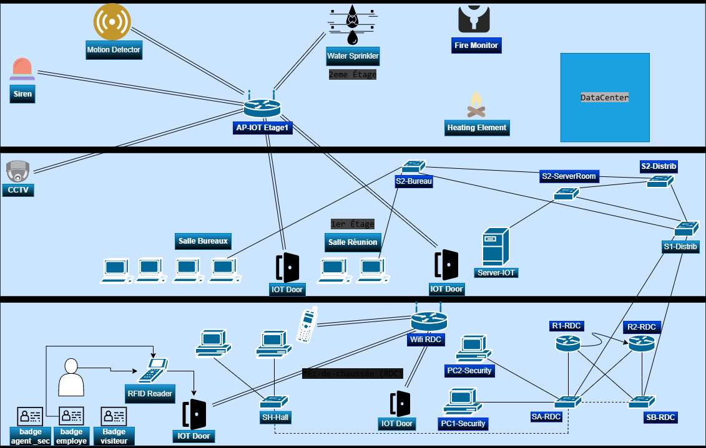
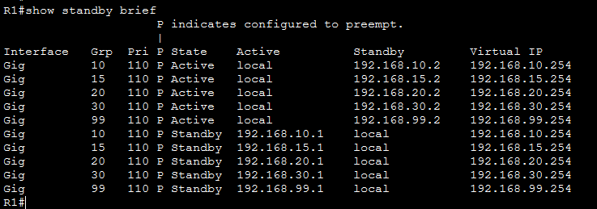

# Smart Business Network & IoT

A Cisco Packet Tracer simulation of a small business network combining segmentation, gateway redundancy and smart-building security scenarios.

**Authors:** Youssef El Ghouari and Abdelkarim Redouani  
**Academic year:** 2025-2026

*Original project topology: offices, network infrastructure and smart-building devices.*

## Network Design

- Five VLANs: Employees, SOC/IT, IoT, Visitors and Management.
- ACLs separating the network segments.
- OSPF area 0 routing.
- HSRP gateway redundancy between two routers.
- RFID access, fire monitoring, sprinklers and CCTV/motion scenarios.

## Gateway Redundancy

*Recorded HSRP status using simulated private IP addresses.*

[IoT scenario and visual sources](docs/project-overview.md)

## Opening the Simulation

Open `Topologie-projet-8.pkt` in Cisco Packet Tracer. Version 9.0.0 is the version recommended in the original coursework instructions. Let the topology initialize; Packet Tracer's fast-forward control can help protocols converge.

The topology uses simulated private IP addresses and laboratory device configuration. It is not a real business deployment and must not be used as a production configuration template.

Simulation checks

1. Inspect VLAN assignments and inter-VLAN access rules.
2. Test permitted and denied connectivity paths.
3. Inspect OSPF neighbours and routing tables.
4. Simulate a router failure and observe HSRP behaviour.
5. Exercise the RFID and fire-alarm scenarios.

These are reproduction checks, not claims that Packet Tracer has been rerun during this publication review.

## Credits

Joint coursework by Youssef El Ghouari and Abdelkarim Redouani, supervised by Soukayna Riffi Boualam. Cisco Packet Tracer is not bundled. No license is assigned to the simulator or other third-party material.
