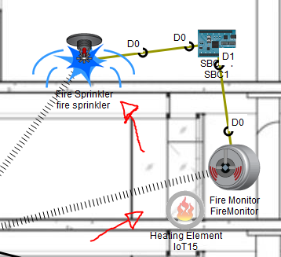
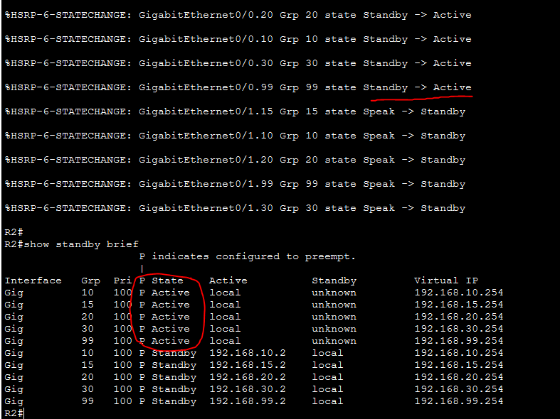

# Smart-Building Scenario

The report and presentation connect network security to building operations: segmented office and IoT traffic, redundant gateways, RFID access, CCTV supervision and fire-response devices.

## Fire Response

Fire-response devices and connections shown in the original report. This illustrates the simulated scenario, not a real safety installation or a new execution test.

## Gateway Failover

The report records a router-failure scenario in which R2 becomes active for the virtual gateways. It also describes restoring R1 and using preemption to recover the preferred gateway. This is historical simulation evidence, not a measured convergence-time guarantee.

## Control and Evidence Map

| Goal | Design | Evidence to inspect |
| --- | --- | --- |
| Separate network groups | Five VLANs and ACLs | VLAN table and device ACL configuration in the `.pkt` file |
| Maintain gateway availability | HSRP between R1 and R2 | Baseline status and recorded failover output |
| Route between network devices | OSPF area 0 | Inspect neighbours and routes when reproducing the lab |
| Detect presence | Motion sensor, siren and CCTV rules | Recorded monitoring dashboard |
| Simulate a fire response | Fire monitor, controller and sprinkler | Fire-response device illustration |

The IoT report describes both activation on detected movement and reset when movement stops. The static dashboard is a recorded state, not a video of both transitions.

## Suggested Reproduction

1. Open the `.pkt` file and allow the topology to converge.
2. Inspect VLAN membership, trunks, ACLs and OSPF routes.
3. Test both allowed and denied paths; a timeout alone does not prove an ACL worked.
4. Disable and restore a router interface to inspect HSRP transitions.
5. Exercise the motion and fire scenarios and inspect sensor/action states.

These are reproduction instructions, not newly completed tests. Use the original coursework's recommended Packet Tracer version 9.0.0.

## Visual Sources

All six images are unchanged extracts from `Rapport-Technique-Projet-8.pdf`:

| Figure | Page |
| --- | --- |
| Network topology | 4 |
| HSRP gateway status | 5 |
| Fire-response scenario | 20 |
| VLAN assignments | 9 |
| Motion and CCTV monitoring | 21 |
| HSRP failover | 25 |

Full reports and presentations are not redistributed here. Joint coursework by Youssef El Ghouari and Abdelkarim Redouani, supervised by Soukayna Riffi Boualam.
